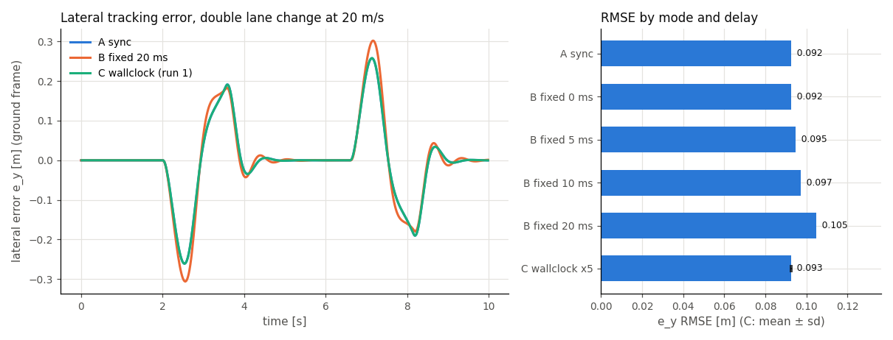

# Closed-loop evaluation modes

`python/vdsim_closedloop.py` runs one controller callback against a
`VDSimPlant` under three timing models, so the cost of controller computation
delay and loop jitter can be measured with everything else held equal. The
controller does not change between modes; only the `mode` string does.

```python
from vdsim_closedloop import ClosedLoopEval, LatencyModel

def controller(obs, t):            # obs: VDSimPlant observation dict at time t
    return delta_rad, fx_total_n

ev = ClosedLoopEval(
    plant_kwargs=dict(level="L2", substep_dt=5e-4),
    controller=controller,
    control_period=0.02,           # Tc [s], a whole multiple of substep_dt
    mode="virtual_async",          # "sync" | "virtual_async" | "wallclock"
    latency=LatencyModel.fixed(0.010),
    overrun="skip",                # "skip" | "queue"
    duration=10.0,
    trace_path="runs/b10.vdtrace", # optional .vdtrace
    reference_path=path_xy,        # optional (M, 2) polyline -> e_y stats
)
res = ev.run()                     # res.trace, res.samples, res.stats, res.meta
```

## Which mode to use

| Mode | Clock | Delay in the loop | Reproducible | Use it for |
|---|---|---|---|---|
| A `sync` | virtual, one thread | none: command applied at its sample time | bit for bit | the reference result; identical to a `VDSimPlant.step` loop |
| B `virtual_async` | virtual, one thread | `c_k` from a `LatencyModel`, inserted in virtual time | bit for bit for `fixed` and seeded distributions | sweeping a delay budget; regression tests of delay sensitivity |
| C `wallclock` | wall clock, C++ sim thread + Python control thread | whatever the host really took, OS jitter included | statistically only | checking that a controller keeps up in real time on a given host |

### A `sync`

At `t_k = k*Tc` the observation is sampled, the controller is called and its
command is applied at once and held for one period (zero-order hold). The
result is bit-identical to the documented `VDSimPlant` loop.

### B `virtual_async`

The sample at `t_k` produces a command that takes effect at

```
t_apply = ceil((t_k + c_k) / substep_dt) * substep_dt
```

The previous command stays in force until then; the plant keeps integrating
substep by substep. One worker computes one sample at a time: sample `k`
starts at `max(t_k, finish of k-1)`.

When a computation runs past the next grid point (`c_k > Tc`) the run is in
overrun and the `overrun` policy decides:

- `skip`: samples that fall due while the worker is busy are not taken; the
  next sample is the first grid point at or after the finish.
- `queue`: every grid sample is taken at its own time and computed in order,
  so the delay accumulates while `c_k > Tc`.

Both count overruns in `stats["n_overrun"]`; `skip` also counts
`stats["n_skipped"]`.

Latency models:

| Model | `c_k` | Reproducible |
|---|---|---|
| `LatencyModel.fixed(c)` | `c` every sample | yes |
| `LatencyModel.uniform(lo, hi, seed)` | `U[lo, hi]` from a generator seeded per run | yes, per seed |
| `LatencyModel.normal(mu, sd, seed)` | `max(0, N(mu, sd^2))`, clipped at zero because a computation cannot finish before it starts | yes, per seed |
| `LatencyModel.measured()` | wall time of the controller call (`time.perf_counter`) | no |

`fixed(0)` reproduces mode A bit for bit for both policies.

### C `wallclock`

A C++ `vdsim.RealTimeRunner` ticks the session every `substep_dt` of wall
clock with Python's global interpreter lock (GIL) released. A Python thread wakes every `Tc`, snapshots the
session, calls the controller and latches its command through the same
`Fx -> wheel torque` mapping that `VDSimPlant` uses. The controller may block
or spin; the sim keeps advancing (the delay is real, not modelled).

`stats` reports the control period p50/p99/max (median, 99th percentile, maximum), the wake jitter, the
sample-to-apply delay, overruns, skipped slots and the real-time factor
`rtf = elapsed virtual time / elapsed wall time` (closer to 1 is better).
`ev.stop()` ends a run early from any thread; every exit path (normal end,
controller exception, `stop()`, `KeyboardInterrupt`) joins both threads
before `run()` returns.

Options that exist only in this mode:

- `cpu_affinity={"sim": 2, "ctrl": [3]}` pins the sim thread to one core and
  the control thread to a core set. **Linux only** (`sched_setaffinity`); on
  other platforms the request is ignored and `stats["sim_affinity_applied"]` /
  `stats["ctrl_affinity_applied"]` say so. The default (`None`) inherits the
  process affinity, so `taskset` around the process decides.
- `watchdog={"timeout_s": 0.1, "failsafe_u": (0.0, -2000.0)}` latches a
  fail-safe command whenever no command arrived for `timeout_s`; latches are
  counted in `stats["failsafe_latches"]`.

## What each mode does not promise

- A and B do not measure your controller's speed; B uses the delay you give it
  (or, with `measured()`, a single host's timing without OS scheduling).
- **C is not reproducible.** Two runs differ; compare distributions, not runs.
- **C jitter depends on the host load and the OS scheduler. VDSim does not
  provide real-time kernel guarantees.** The numbers below are what one shared
  Linux host gave, not a bound.
- Core pinning is Linux-only (see above).
- A queued sample in C is the state when the control thread gets to it, not
  the state at its slot: a real-time loop cannot read the past.

## Results and trace

- `res.trace`: arrays per control sample (`t`, pose and velocities,
  `u_steer`/`u_fx` = command in force at that instant). A and B are on the
  grid `t_k = k*Tc` plus a closing row at `duration` without a command; C has
  one row per wall-clock sample (irregular `t`).
- `res.samples`: one row per controller sample actually taken: `k`,
  `t_sample`, `t_apply`, `c_k`, `overrun`, `applied`, the command, and the
  measured compute time `t_compute_s`.
- `res.meta`: `eval_mode`, `control_period_s`, `latency_model`,
  `overrun_policy`, `delta_sw_ratio`, level and (C) affinity and watchdog;
  the provenance of [Using VDSim from another repository](#using-vdsim-from-another-repository);
  `longitudinal` / `accel_conversion` ([Acceleration command](#acceleration-command));
  `ref_point` and `tracking_point` ([Reference point](#reference-point)).
- `trace_path=` writes a `.vdtrace` (schema 0.5) with one row per control
  sample. A writes exactly what `VDSimPlant.enable_trace` writes. B and C add
  four channels that describe the command in force on that row:

  | Channel | Unit | Meaning |
  |---|---|---|
  | `t_sample` | s | virtual time at which that command's observation was sampled |
  | `t_apply` | s | virtual time at which it took effect |
  | `c_k` | s | its computation delay (B: the latency model; C: measured) |
  | `overrun` | - | 1 when its computation ran past one control period |

  The rows before the first computed command carry NaN times and
  `overrun = 0`. The manifest records `eval_mode`, `control_period_s`,
  `latency_model` and `overrun_policy` in every mode. The four channels are
  optional and additive, so the schema stays 0.5 and an existing 0.5 reader
  ignores them.

## Ending a run early

`ev.stop()` ends a run in every mode. Call it from the controller or from any
other thread; `run()` then returns what ran so far.

| Mode | Where the run ends | The command of the stopping call |
|---|---|---|
| A `sync` | a `stop()` made while a controller call runs: at that sample's time `t_k`; a `stop()` made between calls: at the next grid time, before that sample is taken | not applied; the plant is not advanced |
| B `virtual_async` | as in A, at the virtual time of the call. A `queue` sample computed late behind a busy worker is called at the substep the worker frees up, so the run ends there (the plant cannot go back to `t_k`) | not applied; every command still waiting for its `t_apply` is dropped too |
| C `wallclock` | the control thread stops at its next slot and the sim thread is joined; the run ends wherever the session clock got to | unchanged from before |

- `stats["stopped_early"]` (bool) and `stats["t_stop"]` (simulated end time
  [s], `None` when the run went the full duration) are present in every mode.
  `meta["duration_s"]` stays the nominal duration; the run's real length is
  `t_stop`.
- Dropped commands are counted in `stats["n_unapplied"]` with `applied = 0`
  in `res.samples`; they never appear as a `t_apply` in the trace.
- `res.trace` ends with a closing row at `t_stop` (no command), and the
  tracking metrics of `reference_path` use only the samples that ran.
- A recorded trace is finalized normally: its last row is `t_stop` (when that
  row falls on the decimation grid; at `Tc >= 10 ms` it always does) and the
  manifest carries `stopped_early` and `t_stop`. A run that is not stopped
  records `stopped_early: false, t_stop: null`.
- `stop()` before `run()` has no effect: every run starts cleared.

## Realized steer

The observation carries the steer the dynamics actually integrated, after the
actuator chain (dead time, lag, rate limit) of `actuator=`:

| Key | Unit | Meaning |
|---|---|---|
| `delta_rw` | rad | realized road-wheel steer over the last substep before the sample. With `actuator=None` it equals the command in force, bit for bit |
| `delta_sw` | rad | `delta_rw x steering_ratio`, only when the vehicle file states `steering_ratio`; no default ratio stands in for it. The ratio used is `meta["delta_sw_ratio"]` (`None` = not observed) |

`res.trace` has a `delta_rw` column. `trace_channels=("steer_applied",)` adds
the same quantity to the `.vdtrace` as an optional channel (rad); it is off by
default so the default trace is unchanged, and a 0.5 reader that predates it
ignores it. Per-wheel steer angles are not observed: the direct-control
plant applies one road-wheel angle.

Yaw acceleration `r_dot` is not provided: the dynamics' derivative cannot be
read out without a core interface change, and a finite difference of `r` is
not offered in its place.

## Reference point

`ref_point=` (a `VDSimPlant` argument, so it also goes in `plant_kwargs`) adds
the motion of one body point to every observation. `X`, `Y` stay at the CG.

| Value | Point (body frame, ISO 8855: x forward, y left) |
|---|---|
| `None` (default) | nothing added |
| `"cg"` | `[0, 0]` |
| `"rear_axle"` | `[-cg_to_rear, 0]` |
| `"front_axle"` | `[cg_to_front, 0]` |
| `[x_fwd, y_left]` | that offset [m] |

| Key | Unit | Meaning |
|---|---|---|
| `X_ref`, `Y_ref` | m | ground position of the point |
| `vx_ref`, `vy_ref` | m/s | its velocity in the body frame, `v_P = v_CG + r x p`: `vx - r*y_left`, `vy + r*x_fwd` |

`meta["ref_point"]` and the trace manifest record the setting, the offset
used and `cg_to_front_m` / `cg_to_rear_m`. The tracking error of
`reference_path` is still measured at the CG (`meta["tracking_point"] = "cg"`).

## Acceleration command

With `longitudinal="accel"` the second command element is a longitudinal
acceleration target [m/s^2] instead of a force [N]:

```python
ev = ClosedLoopEval(dict(config="generic_sedan.yaml", longitudinal="accel"),
                    controller,           # returns (delta_rad, ax_mps2)
                    control_period=0.02)
```

- One converter: the session's L5 cascade, `LongAxController` (PI plus
  feed-forward on the measured `ax`), the class and gains the RL `accel`
  action uses. Its pedal output becomes wheel torque linearly:
  `throttle x drive_torque_ref` and `brake x brake_torque_ref`, split with the
  vehicle's front share. Non-positive references fall back to
  `max_motor_torque x final_drive_ratio` and `max_brake_torque`.
- No resistance or mass feed-forward is added; the integrator absorbs the
  steady drag and rolling resistance. The target is not clamped; full pedal
  is the ceiling.
- Not the RL `accel` response: the RL environment's pedals drive the
  vehicle's powertrain map, while here they scale the linear torque
  references above.
- `meta["accel_conversion"]` (and the trace manifest) records the converter,
  its gains, both references and these choices. In `force` mode it is `None`
  and the manifest has neither key. `u_fx` in the result and trace holds
  the acceleration target in `accel` mode.
- L1 is refused: the bicycle model reports `ax = 0`, so the feedback has
  nothing to track.

## Using VDSim from another repository

Pin a commit, build the bindings and install the Python layer in editable
mode:

```bash
git clone https://github.com/Onlyti/VDSim.git && cd VDSim
git checkout <sha>
pip install -e .            # builds the bindings (scikit-build-core)
python -c "import vdsim; print(vdsim.__version__, vdsim.__git_sha__, vdsim.__git_dirty__)"
```

The build bakes the source HEAD into the module: `vdsim.__git_sha__` (40 hex
digits, `"unknown"` without git at build time) and `vdsim.__git_dirty__`
(`True` when tracked files differed from HEAD, `None` when unknown). Every
result carries it, so a stored result says what it ran on:

```python
res = ev.run()
assert res.meta["vdsim_git_sha"] == "<sha>"
res.meta["vdsim_version"], res.meta["param_hash"], res.meta["vehicle_config"]
res.meta["level"], res.meta["actuator"]   # None, {"preset": id} or {"param_hash": ...}
```

The same functions fill the trace `repro` block. Tagged releases and PyPI
packages are not published for this yet; pin by SHA.

## Example: delay budget of a lane-change controller

`examples/closed_loop_eval_demo.py` runs a Stanley-type lateral controller
with a speed loop on a double lane change (3.5 m over 30 m, 20 m/s, L2,
`Tc = 20 ms`, `substep_dt = 0.5 ms`) as A, B with fixed delays of 0, 5, 10 and
20 ms, and C five times.

Metric: `e_y` = signed distance [m] from the CG to the closest point of the
reference polyline, along its normal, ground frame
(`vdsim_closedloop.lateral_error`); RMSE over every control sample (lower is
better). C is the mean ± standard deviation of five runs.

```bash
taskset -c 0-9,12-23 python3 examples/closed_loop_eval_demo.py --out demo_out
```



| case | e_y RMSE [m] | max abs e_y [m] | samples | overruns |
|---|---|---|---|---|
| A sync | 0.0924 | 0.2609 | 500 | 0 |
| B fixed 0 ms | 0.0924 | 0.2609 | 500 | 0 |
| B fixed 5 ms | 0.0946 | 0.2710 | 500 | 0 |
| B fixed 10 ms | 0.0972 | 0.2818 | 500 | 0 |
| B fixed 20 ms | 0.1048 | 0.3059 | 500 | 0 |
| C wallclock x5 | 0.0927 ± 0.0003 | 0.2634 | 500 (mean) | 0 (total) |

Mode C ran with `load1` = 16.7 on cores 0-9,12-23 (inherited); its sample-to-apply delay p50 was 0.1 ms and its period p99 at most 28.6 ms.

B shows how the same controller loses tracking as its computation delay grows
(B 0 ms equals A exactly). C stays close to A because this controller computes
in well under a millisecond, so its real sample-to-apply delay is a fraction
of a substep.

## Wall-clock jitter measured on a shared host

One Linux host (24 logical cores, cores 10 and 11 excluded with `taskset`),
L2, `Tc = 20 ms`, `substep_dt = 0.5 ms`, 10 s runs, cheap controller.
`load1` is the one-minute load average read just before the run. Control
period = time between consecutive wakes of the control thread; overrun =
latch later than one period after its slot.

| Condition | load1 | Cores | Runs | Period p50 [ms] | Period p99 [ms] | Period max [ms] | Overruns per run (of 500) | RTF |
|---|---|---|---|---|---|---|---|---|
| low load | 2.86–3.90 | inherited 0-9,12-23 | 5 | 20.00 | 20.05–20.07 | 20.06–20.12 | 0/0/0/0/0 | 0.99999 |
| shared-host load | ~17 | inherited 0-9,12-23 | 5 | 20.00 | 22.67–28.68 | 29.41–34.80 | 0/0/0/0/0 | 0.99947–0.99999 |
| shared-host load | ~17 | pinned: sim core 2, control core 3 | 5 | 20.00 | 25.55–33.49 | 30.79–45.28 | 2/4/0/3/0 | 0.99999 |
| shared-host load | ~17 | pinned: sim core 15, control core 13 | 3 | 20.00 | 20.44–30.01 | 30.26–40.09 | 1/0/0 | 0.99879–0.99999 |

All runs on 2026-10-13 with `examples/closedloop_wallclock_bench.py` and the
S6 test; RTF is given to five decimals.

Under heavy load the period p99 spreads to roughly 20-34 ms while the RTF
stays near 1; at low load it stays within about 0.1 ms of `Tc`.

## Limits observed under load

The wall-clock pass lines (S6 RTF band, S7 "sim keeps ticking while the
controller blocks") are registered as the ctest `closedloop_wallclock_timing`
with the label `timing`. The `validation` preset and the CI build jobs exclude
that label because a shared CI runner's load is not under our control; the
verdicts are measured locally at low load instead.

S7 asserts that at least 96 of the nominal 120 sim ticks (0.8 x 120) happen
while the controller blocks for `3*Tc`. Observed failure rates:

| Condition | load1 | Runs | Runs below 96 ticks | Fewest ticks |
|---|---|---|---|---|
| low load, 4 variants (sleep / GIL-holding spin x skip / queue) x 20 | 3.13–3.97 | 80 | 0 | 120 |
| shared-host load, standalone | 13.8–18.7 | 80 | 0 | 104 |
| shared-host load, right after a 10 s S6 run | 16.3–20.6 | 40 | 1 | 86 |
| shared-host load, inside a full ctest run | ~18–20 | 2 suite runs | 2 | 82 |

On a heavily loaded host expect occasional misses of the tick floor; measure
mode C on a quiet machine or treat its numbers as host-specific.

Each `wallclock` result carries flags to filter on:

- `stats["load1_start"]`: 1-minute load average just before the run (Linux;
  `None` elsewhere).
- `stats["rtf_windows"]`: RTF per 1 s of wall clock, `p01` / `p50` / `p99` /
  `min` and the window count `n` (`None` under two windows).
- `stats["quality"] = {"ok": bool, "reasons": [...]}` with fixed rules:
  `"rtf_band"` when `|rtf - 1| > 0.02`, `"sim_max_lag"` when
  `sim_max_lag_s > Tc`, `"sim_ticks_short"` when a run that was not stopped
  took fewer substeps than planned. These rules watch the sim thread only; a
  late controller shows in `n_overrun` and the delay statistics.

```python
runs = [ev.run() for _ in range(5)]
kept = [r for r in runs if r.stats["quality"]["ok"]]
```

Contention on the controller side adds delay too: an inference library
whose thread count is not fixed can compete with the sim thread for cores.
