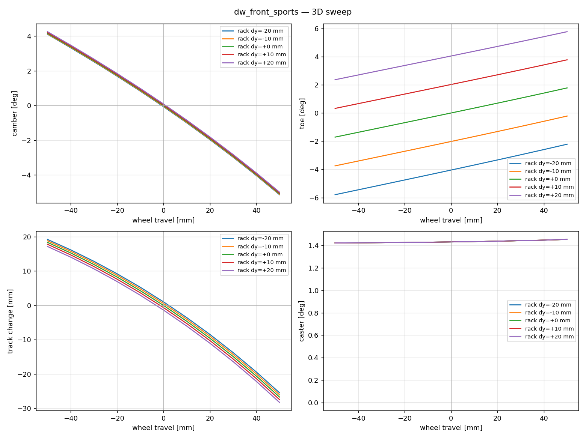

# 14. Hardpoint Kinematics (Ld4)

## Learning objectives

이 chapter 를 마치면 다음을 할 수 있다.

1. suspension 운동학의 공통 입출력 (travel, steer → camber, toe, track,
   caster) 과 강체 knuckle 의 회전으로부터 각도를 추출하는 방법을 안다.
2. 4 topology (double wishbone / MacPherson / trailing arm / 5-link) 각각의
   joint 제약과 풀이 방법을 설명한다.
3. Gruebler mobility 로 각 topology 의 자유도가 닫히는지 검증한다.
4. lookup (offline CSV 보간) 과 native (runtime 풀이) 두 backend 가 하나의
   인터페이스로 통일되는 구조를 설명한다.

## Prerequisites

- **Chapter 13** — multibody 데이터 모형, hardpoint/joint abstraction.
- **Chapter 06** — Ld3 와의 통합 지점 (camber/toe → Pacejka).
- **외부** — 강체 회전 (rotation matrix, axis-angle), Newton/LM, Gruebler.

---

## 14.1 동기 — 공통 black-box 인터페이스

모든 suspension 의 운동학은 동일한 인터페이스를 갖는다.

```
입력: (wheel_travel, steer_input)
출력: (camber, toe, track_change, caster)
```

- `wheel_travel` [m] — bump 양수 (wheel 이 chassis 대비 위로).
- `steer_input` — DW/MP 는 steering rack lateral displacement [m]; rear
  (TA/5-link) 는 무시.
- `camber` [rad] — wheel plane 의 y-z tilt (좌측 wheel: top 이 +y 면 양수).
- `toe` [rad] — spin axis 의 x-y 회전 (toe-in 양수).
- `track_change` [m] — wheel center 의 y 변위.
- `caster` [rad] — kingpin axis 의 x-z tilt.

---

## 14.2 가정

| 가정 | 의미 | 깨지는 case |
|---|---|---|
| 강체 link/knuckle | bushing compliance 없음 | Ld5 |
| Kinematic only | force coupling 없음 | force feedback |
| Front-only steer | rear steer 없음 | 4WS |
| Quasi-static FK | 동역학 없음 (자세만) | full DAE |

---

## 14.3 강체 운동학의 공통 패턴

knuckle 은 강체. 정적 wheel center 를 기준점으로, hardpoint 정적 offset 을
knuckle frame 에 고정. travel 에 따라 knuckle 이 회전·평행이동하면:

$$
p_{\text{world}}(R, t) = LK + R\,(p_{\text{static}} - LK_{\text{static}})
$$

$R$ 은 knuckle 회전 (정적 대비), $LK$ 는 현재 lower-knuckle 위치. camber/toe 는
회전된 spin axis 에서:

$$
\begin{aligned}
\text{spin}_{\text{world}} &= R \cdot \text{spin}_{\text{body}} \\
\text{camber} &= \operatorname{atan2}(-\text{spin}_z,\; |\text{spin}_y|) \quad(\text{좌; 우 부호 반전}) \\
\text{toe} &= \operatorname{atan2}(\text{spin}_x,\; \text{spin}_y)
\end{aligned}
$$

각 topology 의 차이는 joint 제약이 $R$ 을 어떻게 결정하느냐에 있다.

---

## 14.4 Double wishbone — sequential closed-form

UCA/LCA 가 각각 chassis revolute axis 를 갖고, knuckle 은 LK/UK/TK 세 ball
joint 로 부착. Gruebler mobility (N=4: chassis, LCA, UCA, TieRod):

| joint | type | 제약 c |
|---|---|---|
| LCA-chassis | revolute | 5 |
| LCA-knuckle | ball | 3 |
| UCA-chassis | revolute | 5 |
| UCA-knuckle | ball | 3 |
| TieRod-rack | ball | 3 |
| TieRod-knuckle | ball | 3 |

$M = 6(N-1) - \sum c = 24 - 22 = 2$. tie rod 자체 축 회전이 passive DOF 1 →
active $M=1$ (wheel travel). steer 입력 1 로 닫힌다.

풀이 순서 (sequential, global solve 불필요):

1. LCA 각 $\theta_l$ — wheel travel 목표로 Newton:
   $$\text{wheel}_z(\theta_l) = (LK(\theta_l) + R(\theta_l)\,\text{off}_{\text{wheel}})_z \overset{!}{=} z_{\text{static}} + \text{travel}$$
   진짜 wheel z 를 써야 한다 (small-angle 근사 $LK_z+\text{off}_z$ 는 ±50 mm
   에서 ~3 mm 오차).
2. UCA 각 $\theta_u$ — $|UK - LK| = L_{LU}$ 보존하도록 sphere-sphere Newton.
3. TK — 3-sphere trilateration (LK/UK/tie_rod_inner 중심, 반경 $L_{LT}/L_{UT}/L_{tr}$),
   정적 위치에 가까운 해 선택.
4. knuckle frame — (LK→UK) 를 kingpin x축, TK 로 y축 평면 → $R_{\text{now}}$,
   $R_\Delta = R_{\text{now}} R_{\text{static}}^T$.



DW 의 (travel, steer) sweep — camber/toe/track/caster 4 곡선. lookup table 의
source.

---

## 14.5 MacPherson — cylindrical joint 제약

DW 와 차이: UCA 가 없고 strut 이 그 역할. strut tube 는 knuckle 에 강체 결합,
chassis top mount 는 spherical bearing, 내부는 telescoping (스프링 압축) + 축
회전 허용 → cylindrical joint.

핵심: strut 의 제약은 "strut 길이 일정" 이 아니라 "tube axis 가 top mount 를
통과" 이다. compression 길이는 자유 (스프링이 결정), 방향만 구속.

$$
\text{tube\_axis}_{\text{body}} = \frac{ST_{\text{static}} - SK_{\text{static}}}{\|ST_{\text{static}} - SK_{\text{static}}\|}
$$

회전 후 cross-product 제약 (3 scalar, 1 redundant):

$$
(SK_{\text{world}} - ST_{\text{chassis}}) \times (R \cdot \text{tube\_axis}_{\text{body}}) = 0
$$

tie rod 거리 제약 1 scalar 추가 → knuckle 3 회전 DOF 가 닫힌다. LM 으로 푼다.
strut 을 양단 ball-joint 고정길이 막대로 모델하면 (sphere 제약 1 scalar) 축
회전이 미닫혀 발산 → regularization hack + 비현실적 camber gain (~1°/mm). 올바른
cylindrical 제약으로는 0.034°/mm (sedan 표준), 단발 LM 수렴.

---

## 14.6 Trailing arm — 단일 revolute

가장 단순. arm + knuckle + wheel 이 한 강체, chassis 측 single revolute axis.
$M = 6 - 5 = 1$ (wheel travel), steer 없음. axis 방향이 gain 을 결정한다:

- pure trailing (axis ∥ +y): camber/toe gain 0.
- semi-trailing (axis 에 x 또는 z 성분): gain 발생.

풀이: arm 회전각 $\theta$ 하나만 Newton (wheel z 목표).

---

## 14.7 5-link — general multilink

가장 일반적 (다른 topology 가 특수 케이스). 5 개의 양단 ball-joint rigid link.
knuckle 6-DOF, 각 link 1 length 제약 → 5 제약 + wheel-z 입력 1 → 6 제약 on
6 DOF, 닫힘.

knuckle pose $= (x, y, z, \text{axis-angle})$ 6-vector. 잔차:

$$
\begin{aligned}
r_i &= \|\text{pos} + R\,\text{off}_{\text{knuckle},i} - \text{chassis}_i\| - L_{\text{link},i}, \quad i=1\ldots5 \\
r_6 &= \text{pos}_z - (z_{\text{static}} + \text{travel})
\end{aligned}
$$

Levenberg-Marquardt. continuation (이전 sweep 해를 warm-start) 으로 부드러운
단조 해 family.

---

## 14.8 두 backend — lookup vs native

같은 `ISuspensionKinematics` 인터페이스에 두 구현:

| Backend | 특성 |
|---|---|
| Lookup | offline solver 의 (travel × steer) CSV 를 bilinear 보간. O(1). |
| Native | runtime 에 hardpoint 직접 풀이. hardpoint 가 변하는 케이스 (compliance). |

native 출력이 grid point 에서 lookup 과 $<10^{-3}$ rad 일치.

---

## 14.9 Ld3 와의 연결

`fourteen_dof` 가 매 substep: (1) per-wheel travel $= z_u - z_{\text{corner,sprung}}$
(bump 양수), (2) `compute(travel, steer)` → camber, toe, (3) 좌/우 mirror 부호,
(4) Ld2 의 Pacejka `gamma` 입력 + wheel steer 에 toe 가산. 이것이 chapter 06 의
phenomenological `camber_per_roll · φ` 를 대체한다. attach 안 하면 legacy
fallback (back-compat).

---

## 14.10 검증 전략

| 검증 | 케이스 |
|---|---|
| Gruebler mobility | 각 topology 의 active DOF = 입력 수 |
| Wheel-z 정확도 | true wheel z Newton 후 < 0.1 μm |
| native↔lookup | grid point 에서 $<10^{-3}$ rad 일치 |
| self-consistency | diagnose.py 4 type gain 이 차종 표준 범위 |

---

## 14.11 한계

| 항목 | 현재 |
|---|---|
| Compliance (bushing) | 없음 — 강체 joint (Ld5) |
| Steer 통합 | DW/MP rack displacement 만; rear steer 없음 |
| Anti-dive/squat 정량 | kinematic 만; force 효과 미반영 |
| Tire force coupling | camber/toe → tire 입력만 (역방향 없음) |
| K&C chart | sweep CSV + plot; Adams 형식 미구현 |

---

## 14.12 다음 chapter 와의 연결

chapter 13-14 가 multibody kinematics (Ld4) 를 완성했다. chapter 15 는 이 모든
ladder 의 정확성을 보증하는 validation + DOE (ISO 표준 기동) 를, chapter 16 은
FMI 표준 통합을 다룬다.

---

## 14.13 참고문헌

- **Milliken & Milliken**, *Race Car Vehicle Dynamics*, SAE, 1995, §17 suspension geometry / instant center / roll center.
- **Reimpell, Stoll, Betzler**, *The Automotive Chassis*, 2001, K&C / suspension types.
- **Gillespie, T.**, *Fundamentals of Vehicle Dynamics*, SAE, 1992, camber/toe gain 정의.

---

## 14.14 Self-check

<details>
<summary>1. DW 의 wheel-z Newton 에서 true wheel z 를 써야 하는 이유?</summary>

small-angle 근사 $LK_z+\text{off}_z$ 는 knuckle 회전을 무시해 ±50 mm travel
에서 ~3 mm 오차. 회전된 wheel center 의 실제 z 를 target 으로 풀어야 정확.
</details>

<details>
<summary>2. MacPherson 을 고정길이 막대로 모델하면 왜 발산하나?</summary>

sphere 제약 1 scalar 만으로는 knuckle 의 strut-축 회전이 미구속 → 해가 닫히지
않아 발산/regularization 필요. cylindrical (cross-product 3, 1 redundant) 제약이
방향만 구속하고 길이는 자유로 둬야 정확.
</details>

<details>
<summary>3. trailing arm 의 camber gain 이 axis 방향에 의존하는 이유?</summary>

pure trailing (axis ∥ y) 은 회전이 순수 pitch-up 이라 camber/toe 불변. axis 에
x/z 성분(semi-trailing)이 있으면 회전이 wheel plane 을 기울여 gain 발생.
</details>

<details>
<summary>4. 5-link 가 다른 topology 의 일반형인 이유?</summary>

5 개 length 제약 + knuckle 6-DOF 의 일반 LM 문제. DW/MP/TA 는 link 일부가
revolute/ball/strut 로 특수화된 경우로, 같은 6-제약 풀이의 부분집합이다.
</details>

<details>
<summary>5. lookup backend 가 native 와 거의 같은데도 native 가 필요한 이유?</summary>

lookup 은 고정 hardpoint 의 사전 sweep. hardpoint 가 runtime 에 변하는 경우
(compliance, 설계 편집, live editor) 는 native 가 즉시 재풀이해야 한다.
</details>

---

## 14.15 VDSim 구현 노트

> **[VDSim impl] § 14.1 — 인터페이스 코드**
>
> `core/include/vdsim/suspension.hpp`:
> ```cpp
> class ISuspensionKinematics {
> public:
>     struct Output { double camber, toe, track_change, caster; };
>     virtual Output compute(double wheel_travel,
>                            double steer_input) const noexcept = 0;
> };
> ```

> **[VDSim impl] § 14.4-14.7 — solver 파일 + 샘플**
>
> | topology | Python | C++ native | 샘플 gain |
> |---|---|---|---|
> | DW | `dw_3d_solver.py` | `dw_native_kinematics.cpp` | camber −0.094°/mm, RC 7.5 cm |
> | MP | `mp_3d_solver.py` | `mp_native_kinematics.cpp` | camber 0.034°/mm, strut 19.4° |
> | TA | `ta_3d_solver.py` | `ta_native_kinematics.cpp` | camber 0.022, toe 0.009°/mm |
> | 5-link | `fivelink_3d_solver.py` | `fivelink_native_kinematics.cpp` | camber 0.019, toe 0.026°/mm |
>
> 회계 상세: `docs/tasks/T27_ld4_dw`~`T30_ld4_5link/REPORT.md`.

> **[VDSim impl] § 14.8 — backend factory + 검증**
>
> `create_lookup_kinematics(csv)` (bilinear), `create_{dw,mp,ta,5link}_native_kinematics(yaml)`.
> 일치 검증: `tests/unit/test_suspension_lookup.cpp`.

> **[VDSim impl] § 14.9 — Ld3 attach**
>
> ```cpp
> auto k = vdsim::create_lookup_kinematics("dw_front.csv");
> vdsim::attach_front_kinematics(*l3_dyn, std::move(k));
> ```

> **[VDSim impl] § 14.x — toolchain**
>
> ```
> hardpoint YAML (configs/suspensions/*.yaml)
>   ├─ tools/kinematics/diagnose.py          self-consistency
>   ├─ tools/kinematics/*_3d_solver.py       sweep CSV
>   ├─ tools/kinematics/import_hardpoints.py Adams CSV → YAML
>   └─ builder/suspension_editor.html        Three.js live edit (WS → native)
> ```
> `diagnose.py` 출력 예: DW RC 7.5cm/camber −0.094°/mm/wheel-z err <0.1μm,
> MP strut 19.4°, TA semi-trailing 14°/anti-dive 5.5°, 5-link lengths
> [0.36,0.36,0.38,0.38,0.35].


## 14.16 L5 `steer_input` and rack travel

`VehicleParams.steer_input` selects how L5 hardpoint corners read the steer command.
Empty and `roadwheel` keep the 0.8.1 path: wheel angle times `kRackPerRad`.
`rack_travel` copies `SteeringOutput.rack_travel` as physical +y [m] into `steer_rack_dy`
(front only). The S2 right-side invert stays. `kRackPerRad` and Ackerman are not used.
`d_wheel` is `{0,0,0,0}`; the progress angle is DAE product toe (`toe_dae_`).

Product toe = `atan2(spin_x, spin_y)` with right-side `s=-1`
(`multibody_hard_dae.cpp`). On this product, left-wheel product-toe + is ISO 8855 steer -.
Rear-of-axle rack sign correction is the builder's job, not a VDSim code flip.
Hardpoints missing, Dynamic steering, or a bad key raise `ValueError`.
L2-L4 ignore the key (one process warning if it is set).


정지 기하 수용 범위는 적재 차량의 첫 공통 유한 시간 준정적 구간임.
영·양·음 랙을 1 ms 간격으로 동기화하고 첫 0.2 s 영 입력 뒤 랙 적용함.
최대 8 s 안에 모든 실행이 아래 조건을 동시에 0.5 s 연속 만족한 첫 구간만 판정에 사용함.

| 감시량 | 연속 구간 조건 |
|---|---|
| 차체 속도 노름 | ≤ 0.001 m/s |
| 차체 각속도 노름 | ≤ 0.001 rad/s |
| 바퀴별 이동률 절댓값 | ≤ 0.001 m/s |
| 제품 토 변화율 절댓값 | ≤ 0.01 deg/s |
| 바퀴별 수직 하중 변화율 절댓값 | ≤ 1 N/s |
| 감시 채널·수직 하중 | 전부 유한·모든 바퀴 하중 양수 |

동일 시각의 영 랙 대비 제품 토 차분을 고정 기하표와 비교함.
기한 내 공통 정착 부재는 실패이며 8 s 이후 영구 평형 보장은 범위 밖임.

## 14.17 L5 hardpoint output (0.8.2)

L5 strut path에 corner model이 붙은 바퀴는 매 틱 캠버·토·하드포인트 좌표를 출력함.
캠버·토 [rad]는 타이어에 들어간 값과 같은 `free_3d_wheel_camber/toe`이며, 토 부호는 §14.16 제품 토임.
L1~L4(L4 하드포인트 경로 포함)와 corner model이 없는 바퀴는 0, `wheel_kin_valid` false, 점 0개임.

### 출력 좌표계

부품 YAML 설계 좌표계를 차량 하나로 묶은 차체 고정 좌표계임(x 전방, y 좌측, z 상방, ISO 8855).
원점은 앞 차축 중심 아래 지면임.

| 양 | 정의 |
|---|---|
| 앞 차축 x 이동 | Δx_front = 0 − w_front.x |
| 뒤 차축 x 이동 | Δx_rear = −wheelbase − w_rear.x |
| 출력 점 | p_out = p_yaml + Δx_axle·e_x, 우측 바퀴는 y 부호 반전 |
| 바퀴 중심 y 차이 | wheel_center_dy = w.y − track/2 (좌표는 y로 옮기지 않음) |

w는 부품 YAML `wheel.center`임.
동역학 바퀴 장착점은 a·b·track/2를 쓰므로, wheel_center_dy가 0이 아닌 조합은 출력 기하와 장착점이 그만큼 어긋남.
무게중심은 같은 좌표계에서 (−cg_to_front, 0, cg_height)로 manifest에 기록함.

### 형식별 출력 점

| 형식 | 점 (YAML 키, 출력 순서) |
|---|---|
| MacPherson | lca.chassis_front, lca.chassis_rear, lca.knuckle, strut.top, strut.bottom, tie_rod.rack, tie_rod.knuckle, wheel.center |
| Double wishbone | lca.chassis_front, lca.chassis_rear, lca.knuckle, uca.chassis_front, uca.chassis_rear, uca.knuckle, tie_rod.rack, tie_rod.knuckle, (spring_damper.chassis, spring_damper.lca), wheel.center |
| Trailing arm | arm_pivot.chassis_inboard, arm_pivot.chassis_outboard, wheel.center |
| 5-link | 출력 안 함 (아래) |

5-link corner의 구동 좌표 풀이는 미지수 6개에 잔차 7개를 두는 최소제곱 근사임(lower_aft 바깥점을 회전축 원 위에 묶음).
그래서 링크 길이가 정확히 보존되지 않고, 정확해 대비 토가 +30 mm 범프에서 약 2.6° 어긋남.
0.8.2는 5-link 코너의 좌표를 내보내지 않음(count 0, layout `names` 빈 목록, `excluded`에 사유).
캠버·토는 타이어에 들어간 값 그대로 계속 출력함.

### `rack_per_rad`

`roadwheel` 모드의 랙 변위는 바퀴각 × `VehicleParams.rack_per_rad` [m/rad]임(기본 0.08, L4와 L5 공통).
`rack_travel` 모드(§14.16)는 이 키를 쓰지 않음.

### `.vdtrace` 채널과 manifest (schema 0.5)

| 채널 | 모양·단위 | 무효 바퀴 |
|---|---|---|
| `wheel_camber`, `wheel_toe` | (N, 4) [rad] | NaN |
| `hp_<wheel>_<key>` | (N, 3) [m] | 채널 없음 |

채널 이름 규칙: `<wheel>`은 fl·fr·rl·rr, `<key>`는 YAML 키의 점을 `_`로 바꾼 것이며 정규식은 `^hp_(fl|fr|rl|rr)_[a-z0-9_]+$`임.
manifest `hardpoints` 블록은 `frame`, `unit`, `invalid_wheel`(NaN), `channel_rule`, `axle_offset_x`, `wheel_center_dy`, `cg`, `corners`를 가짐.
`corners.<wheel>.points`는 YAML 키 → 채널 이름 사전이며, 제외된 코너는 `points: {}`와 `excluded` 사유를 가짐.
모든 채널은 선택·추가형이라 schema 판은 0.5 그대로이고, 이전 0.5 리더는 새 채널을 무시하고 읽음.
